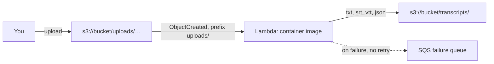

# How it works

## Flow

1. An object is created under `uploads/`. S3 invokes the function asynchronously.
2. The handler checks the event: an allowed bucket, a key under the input prefix, no `.`/`..`/empty path segments or control characters, and output keys that fit S3's 1,024-byte limit.
3. It streams the object (the exact version from the event, when versioning is on) into a fresh temporary directory, rejecting it if S3 reports, or the stream reaches, more than `MAX_INPUT_MB`.
4. PyAV decodes the audio to 16 kHz mono, skipping corrupt packets. faster-whisper transcribes it with the model baked into the image, which is loaded once per execution environment and reused by warm invocations.
5. The transcripts are written to `transcripts/<same path>.<format>`, and the temporary directory is removed.
6. Any error is raised, so Lambda marks the invocation failed and sends the event to the failure queue.

`uploads/team/standup.m4a` becomes `transcripts/team/standup.m4a.txt`, `.srt`, `.vtt` and `.json`. Keeping the original extension in the name means `talk.mp3` and `talk.m4a` don't overwrite each other.

## Security design

Anyone who can upload to `uploads/` can make the function process a file of their choosing, so the design assumes uploads are untrusted:

| Risk | Control |
|---|---|
| Transcripts re-triggering the function | The trigger only covers `uploads/`; outputs go to `transcripts/`. The function refuses to start if either prefix contains the other, and ignores events outside the input prefix. |
| Malicious keys (`../../…`) reaching the filesystem | The S3 key is only ever used as an S3 key. The local file is always `<tempdir>/input`. |
| Crafted media making ffmpeg open other files or URLs | Only the `file` protocol is allowed, and FFmpeg may only open the file with an allowlist of audio/video demuxers (others may probe the bytes but never read the file). Playlists (HLS), concat scripts and subtitle or image formats are refused. Only common audio codecs are decoded. |
| Odd keys flowing into output names | Keys with `.`, `..` or empty segments, or control characters, are skipped, so nothing that later syncs `transcripts/` to disk inherits a traversal-shaped name. |
| Huge or very long files running up cost | `MAX_INPUT_MB` is checked before and during the download, `MAX_AUDIO_SECONDS` (3600 in Lambda) against the header and during decoding, failed invocations aren't retried, and reserved concurrency (5) caps parallel runs. Leftover temporary files from a timed-out run are cleared at the next start. |
| Wider access than needed | The role can read `uploads/*` and write `transcripts/*`, nothing else in the bucket. `ExpectedBucketOwner` is sent on every S3 call. The Lambda permission is limited to the bucket ARN and account. |
| Forged events from direct invocation | Event fields can't prove an event came from S3, so the real boundary is who may invoke the function: the stacks grant it only to S3, for this bucket and account. Anyone you grant `lambda:InvokeFunction` can still submit events. On top of that, `ALLOWED_BUCKETS` is required and rejects other buckets, and no presigned URLs are returned. |
| A tampered build | The base image is pinned by digest, every Python package by hash (wheels only), and every model file by commit and SHA-256. There is no separate ffmpeg download; FFmpeg ships inside the PyAV wheel, so FFmpeg security fixes arrive by updating `av`. |
| Root in the container | The image runs as an unprivileged user (Lambda always uses its own unprivileged user). `make transcribe` runs it with your user ID, no network, no capabilities, and a read-only filesystem, and transcripts are never written through a symlink. The local emulator listens on 127.0.0.1 only and needs an explicit `BUCKET` when given credentials. |

## Image layout

| Path | Contents |
|---|---|
| `/var/task/app.py` | Lambda handler |
| `/var/task/transcriber.py` | Decoding, transcription, output formats, and the CLI |
| `/usr/local/bin/transcribe` | CLI entry point for standalone use |
| `/opt/whisper-model` | The model chosen at build time |
